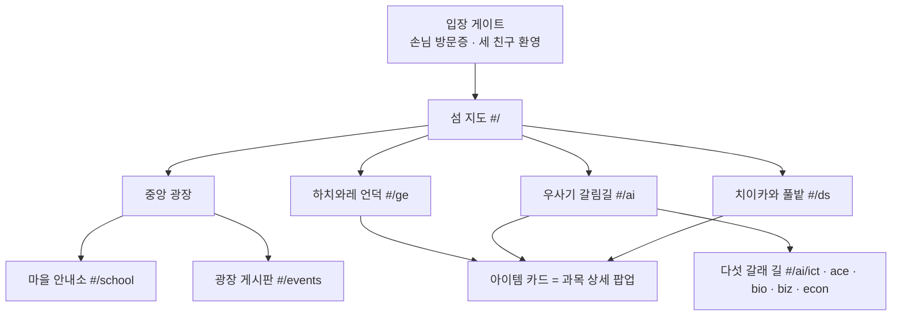

# 먼작귀 마을 — 디자인 마스터 (컨셉 v1)

> AI융합학부 소개 사이트의 LP판 컨셉을 **"먼작귀 마을"** 컨셉으로 바꾸는 디자인 기준 문서.
> **바꾸는 것은 디자인뿐**이고, 과목·학점·요건 같은 내용(`data.js`)은 그대로 둔다.
> 페이지별 예외 규칙이 생기면 `pages/<page>.md`에 적고, 거기 적힌 규칙이 이 문서보다 우선한다.

---

## 0. 한 줄 컨셉

**설명회에 온 사람 = 마을에 놀러 온 "손님".**
세 전공은 각자 자기 마을을 가진 캐릭터이고, 손님은 섬 지도에서 마을을 골라 찾아간다.
마을 안의 **장소**(표지판, 텃밭, 무대 …)를 둘러보면서 전공 정보를 얻는다.
동물의 숲처럼 *지도 → 마을 → 장소 → 아이템(과목)* 순서로 탐험하는 구조다.

---

## 1. 캐릭터 파악 & 전공 매핑

### 1-1. 첨부 이미지 속 캐릭터

| 위치 | 캐릭터 | 생김새 (이미지 기준) | 성격·설정 |
| --- | --- | --- | --- |
| 왼쪽 | **하치와레** | 하얀 고양이. 머리 위가 **푸른 회색(#78A6BD)으로 가르마처럼 갈라진 무늬**, 꼬리 끝도 같은 파랑. 한쪽 눈 윙크, 벌린 입 | 긍정적이고 말을 잘함. 기타 치며 노래(버스킹)하고, 동굴 집에 삶. 입버릇은 "어떻게든 될 거야!" |
| 가운데 | **치이카와** | 새하얗고 동글동글한 몸, **작고 둥근 곰 귀**. 눈을 꼭 감고 웃는 얼굴 | 겁도 많고 잘 우는 편이지만 성실하게 노력함. **풀뽑기(제초) 검정 시험**에 꾸준히 도전 |
| 오른쪽 | **우사기** | **크림 노란색(#FBEFCA) 토끼**, 안쪽이 분홍(#FDC5CA)인 **긴 귀**, 동그란 눈 | 예측할 수 없고 에너지가 넘침. 뭐든 해내는 만능형이고 자격증도 많음. "우라!", "야하!" |
| 공통 | — | 볼에 **분홍 홍조(#FBBEC7)와 빗금**, 굵은 검정 손그림 외곽선 | 셋이 손을 잡고 서 있는 컷 → **오프닝 환영 장면**에 그대로 사용 |

### 1-2. 전공 ↔ 캐릭터 매핑

| 전공 | 캐릭터 | 이렇게 묶은 이유 | 마을 이름 (안) |
| --- | --- | --- | --- |
| **GE** 글로벌 기업가정신 | **하치와레** | 창업에는 무대에 서서 아이디어를 파는 **피칭**과 "어떻게든 된다"는 **낙관**이 필요하다. 버스킹하는 하치와레와 맞는다. 캡스톤은 마을의 *버스킹 무대*가 된다 | 하치와레 언덕 |
| **AI융합** (5트랙) | **우사기** | 만능에 자격증 부자라 ICT·ACE·생명·경영·경제 **다섯 갈래 융합**과 어울린다. 어디로 튈지 모르는 성격이 다학제와 닮았다 | 우사기 갈림길 |
| **DS** 데이터 사이언스 | **치이카와** | 데이터 정제는 결국 **풀뽑기**다. 꾸준히 검정 시험을 보는 성실함은 수학·통계·알고리즘을 차근차근 쌓는 DS와 같다. 졸업 요건 섹션은 *검정 시험장*이 된다 | 치이카와 풀밭 |
| 학부 소개 (`school`) | 세 친구 함께 | 특정 전공이 아니라 마을 전체의 안내소 역할 | 중앙 광장 · 마을 안내소 |
| 학부 행사 (`events`) | — | 동물의 숲의 광장 게시판에 해당 | 광장 게시판 |

> 매핑을 바꾸고 싶으면 `village.js`(아래 6절)의 `character` 값만 바꾸면 된다. 레이아웃은 캐릭터와 상관없이 같다.

---

## 2. 정보 구조 (IA)

### 2-1. 사이트맵



라우트(`#/ge`, `#/ai/ict` …)는 **지금 것을 그대로 쓴다**. 딥링크와 뒤로가기 동작도 바뀌지 않는다.

### 2-2. 내비게이션 계층

```
L0  입장 게이트       ← 첫 방문 1회만 (건너뛰기 가능, 다시 보기는 지도 하단 링크)
L1  섬 지도           ← 지도 위 마을 핀 5개 + 같은 내용을 목록으로도 제공(접근성용)
L2  마을 (전공)       ← 상단: 캐릭터 인사 대화창 / 본문: 장소 카드 스크롤
    └ 장소 내비       ← 기존 album__nav(A1, B2 …) → "마을 안내도" 칩 바
L3  아이템 카드       ← 과목 클릭 시 하단 팝업 (기존 player)
    우사기 마을만: 다섯 갈래 길 이정표 탭 (기존 disc-tab)
```

깊이는 지금과 같은 3단계라 브레드크럼은 필요 없다. 대신 상단 바에 `🗺 지도` 버튼(아이콘은 SVG)과 현재 마을 이름을 둔다.

### 2-3. 섹션 → 장소 이름 (라벨 체계)

화면에 보이는 큰 제목은 **장소 이름**, 그 아래 작은 글씨는 **원래 섹션 제목**이다. 원래 제목을 남겨서 정보를 찾는 사람이 헷갈리지 않게 한다.
`A1/B2` 같은 사이드 번호는 숨기고, 장소 아이콘(SVG)을 붙인다.

| 섹션 id | 공통 장소 | 하치와레 언덕 (GE) | 우사기 갈림길 (AI) | 치이카와 풀밭 (DS) |
| --- | --- | --- | --- | --- |
| `notes` (Liner Notes) | 입구 표지판 | 하치와레의 인사 | 우사기의 인사 | 치이카와의 인사 |
| `tracklist` | 과목 진열대 | 아이디어 장터 | — | 데이터 텃밭 |
| `structure` | — | — | 갈림길 이정표 | — |
| `discs` | — | — | 다섯 갈래 길 | — |
| `common` | — | — | 공용 텃밭 | — |
| `bizcommon` | — | — | 세 갈래 공동 규칙 | — |
| `sequence` | 성장 산책로 | 성장 산책로 | — | 성장 산책로 |
| `credits` | 마을 사무소 | 졸업 체크리스트 | — | **검정 시험장** |
| `capstone` | 무대 | **버스킹 무대** | 축제 무대 | 공동 작업장 |
| `projects` | 작업실 | 작업실 | — | — |
| `md` | — | — | — | 배지 진열장 |
| `others` | 이웃 마을 우편함 | ← | ← | ← |
| `contact` | 문의 우체통 | ← | ← | ← |

**마을 안내소 (`school`)**: A1~A5는 *1층 · 학부 이야기*, B1~B7은 *2층 · 수강 규칙 창구*로 나눈다. 장소 칩 12개를 층 2개로 묶어서 보여 준다.

**기존 LP 용어 바꾸기**

| 기존 | 새 이름 |
| --- | --- |
| 앨범 / Records | 마을 |
| 크레이트(카드 셔플) | 섬 지도 |
| Tracklist / tracks | 과목 진열대 / 과목 N개 |
| SIDE A / B | 진열대 칸 이름 (`g.name`만 표시) |
| ▶ 트랙리스트 재생 | 과목 둘러보기 |
| 플레이어 | 아이템 카드 |
| Disc 1 · ICT | 길 1 · ICT |
| 이전/다음 앨범 | ← 옆 마을 / 옆 마을 → |
| `3:00` (학점 표기) | `3학점` |

---

## 3. 화면 구성

### 3-1. 입장 게이트 (첫 방문)

```
┌──────────────────────────────────────┐
│           ☁       ☁                   │
│     [세 친구 손잡은 일러스트]          │
│                                      │
│  ┌ 하치와레 ┐                         │
│  ╭──────────────────────────────╮    │
│  │ 어서 와, 손님! 여기는        │    │
│  │ AI융합학부 마을이야.         │    │
│  │ 우리가 사는 마을 구경할래? ▼ │    │
│  ╰──────────────────────────────╯    │
│  ┌─────────── 손님 방문증 ─────────┐  │
│  │ 2026 학부설명회 · AI융합학부 마을 │  │
│  │      [ 마을에 들어가기 → ]       │  │
│  └─────────────────────────────────┘  │
│                     건너뛰기          │
└──────────────────────────────────────┘
```

- 대사는 클릭할 때마다 하치와레 → 우사기 → 치이카와 순서로 넘어간다(최대 3줄).
- 본 적이 있으면 `localStorage`에 기록하고 다음부터는 건너뛴다. `try/catch`로 감싸서 저장에 실패해도 게이트가 한 번 더 보일 뿐이다.

### 3-2. 섬 지도 (`#/`)

```
데스크톱 (≥1024)                         모바일 (<768)
┌───────────────────────────────┐      ┌───────────────────┐
│ 손님, 어디로 가볼까?           │      │ 손님, 어디로 갈까? │
│  ╭하치와레 언덕╮   ╭우사기 갈림길╮│      │ [지도 축소판 SVG]  │
│  │ 🎸 언덕·동굴│   │ 5갈래 길    ││      │                   │
│  ╰─────┬─────╯   ╰─────┬─────╯ │      │ ┌ 하치와레 언덕 ┐ │
│        └── 중앙 광장 ──┘        │      │ │ GE · 33학점  →│ │
│         [안내소] [게시판]        │      │ └──────────────┘ │
│              │                  │      │ ┌ 우사기 갈림길 ┐ │
│        ╭치이카와 풀밭╮           │      │ ...              │
│        │ 🌱 텃밭·시험장│          │      └───────────────────┘
│        ╰────────────╯           │
│  ~~~~ 강 ~~~~  🌉               │
└───────────────────────────────┘
```

- 지도는 인라인 SVG 한 장이다(잔디 #CFE8B9, 길은 크림색 점선, 강은 #DDEFF6). 마을 핀은 `<a>` 태그로 만들어 키보드 포커스와 스크린리더 라벨을 갖춘다.
- 핀에 마우스를 올리거나 포커스하면 캐릭터가 통통 튀고, 말풍선으로 `GE · 33학점` 같은 요약을 보여 준다(기존 `card.chip` 재사용).
- 모바일에서는 지도가 장식 겸 미니맵이 되고, 실제로 누르는 대상은 그 아래 **마을 카드 목록**이다(44px 이상 터치 영역).
- 지도 → 마을로 갈 때는 기존 View Transition을 쓴다. 핀이 마을 히어로로 확대된다(`view-transition-name: village`).

### 3-3. 마을 페이지 (`#/ge`, `#/ai`, `#/ds`)

```
┌──────────────────────────────────────────────┐
│ [🗺 지도]   하치와레 언덕 · GE 전공              │ ← sticky 상단 바
├──────────────────────────────────────────────┤
│   (마을 배경: 언덕 + 동굴 + 마을 색 하늘)        │
│        [하치와레 일러스트, idle 통통]           │
│  ┌ 하치와레 ┐                                   │
│  ╭───────────────────────────────────────╮    │
│  │ 손님 안녕! 여기선 기업가 정신이랑      │    │ ← rec.tagline을 대사로
│  │ 기업가치를 만드는 힘을 배워. ▼         │    │
│  ╰───────────────────────────────────────╯    │
│  (33 학점)(21 학점↑)(2 과목)  ← 스탬프 3개     │ ← rec.stats
│  [ 과목 둘러보기 ] [ 성장 산책로 ]             │
├──────────────────────────────────────────────┤
│ 마을 안내도: ●인사 ○장터 ○산책로 ○체크리스트 … │ ← sticky 칩 바
├──────────────────────────────────────────────┤
│ ┌▣ 아이디어 장터 ─────────────────────────┐   │ ← 나무 표지판 헤더
│ │  Tracklist · GE 전공으로 인정되는 과목    │   │
│ │  ┌ 창업역량 · 13개 · 39학점 ──────────┐  │   │
│ │  │ (◎) 글로벌 기업가정신 입문  EN 2학년│  │   │ ← 아이템 행
│ │  │ (◎) 비즈니스 모델 혁신       2학년 │  │   │
│ └──────────────────────────────────────┘   │
│ ...                                          │
│ ← 마을 안내소        우사기 갈림길 →          │
└──────────────────────────────────────────────┘
```

**우사기 갈림길**에만 있는 `다섯 갈래 길`: 탭 대신 **이정표 화살표 5개**를 둔다. 트랙마다 원래 색(`d.color`)으로 표지판을 칠하고, 고른 길은 앞으로 튀어나온다.

### 3-4. 아이템 카드 (과목 상세)

하단에서 올라오는 대화창 모양 패널이다(기존 `player` 자리).

```
╭──────────────────────────────────────────╮
│ (◎ 아이콘)  과목 카드를 확인했다!     ✕  │
│ 기계학습개론                              │
│ Introduction to machine learning          │
│ [AIE23003][3학점][이론 3·실습 0][2학년 1학기][영어강의] │
│ 인정 전공: [DS][AI융합 ICT]…              │
╰──────────────────────────────────────────╯
```

---

## 4. 디자인 토큰

### 4-1. 스타일 방향

ui-ux-pro-max 스타일 DB에서 **Claymorphism**(교육·온보딩·캐주얼 게임용, 굵은 테두리와 둥근 모서리)과 **Anti-Polish / Hand-drawn**(손그림 외곽선)이 나왔다. 둘을 섞어 **"손그림 스티커"** 스타일로 간다.

- 모든 카드·버튼에 **2.5px 잉크색 외곽선**과 **아래로 4px 밀린 단색 그림자**를 준다. 블러 그림자는 쓰지 않는다.
- 모서리는 큰 카드 28px, 칩·버튼은 999px(완전히 둥글게)로 한다.
- 표지판·말풍선 같은 장식은 `rotate(-1.5deg ~ 1.5deg)` 범위에서만 기울인다. 본문 텍스트 블록은 기울이지 않는다.
- DB가 같이 추천한 *Minimalism & Swiss / 오렌지 팔레트*는 이 컨셉과 맞지 않아 쓰지 않는다.

### 4-2. 색 (첨부 이미지에서 추출)

DB 팔레트 검색 결과(펫테크 오렌지, 육아 핑크)가 캐릭터와 맞지 않았다. 그래서 **첨부 이미지에서 직접 색을 추출**하고, 글자용 색만 어둡게 조정했다.

```css
:root {
  /* 바탕 */
  --paper:        #FFFBF2;  /* 크림 종이 — 페이지 배경 */
  --card:         #FFFFFF;
  --ink:          #2B2622;  /* 외곽선·본문 (paper 대비 14.5:1) */
  --ink-soft:     #6B625A;  /* 보조 텍스트 (5.8:1) */
  --grass:        #CFE8B9;  /* 지도 잔디 */
  --grass-deep:   #8DBF7A;
  --water:        #DDEFF6;
  --path:         #F3E6C8;  /* 지도 길 */
  --blush:        #FBBEC7;  /* 공통 홍조 — 강조 배경 */
  --blush-ink:    #B8445C;  /* 홍조 계열 텍스트 (5.1:1) */

  /* 하치와레 (GE) */
  --hachi:        #78A6BD;  /* 머리 무늬 원색 — 면적용 */
  --hachi-tint:   #E3EEF4;
  --hachi-ink:    #36667D;  /* 텍스트·아이콘 (paper 대비 6.1:1) */

  /* 우사기 (AI융합) */
  --usagi:        #FBEFCA;  /* 몸통 크림 — 면적용 */
  --usagi-ear:    #FDC5CA;
  --usagi-deep:   #E9C46A;
  --usagi-ink:    #8A6410;  /* 텍스트 (5.2:1) */

  /* 치이카와 (DS) — 몸이 흰색이라 마을 색은 '풀밭' 초록 */
  --chii:         #FFFFFF;
  --chii-tint:    #E8F4DE;
  --chii-ink:     #3F7A3A;  /* 텍스트 (5.0:1) */

  /* 마을별로 덮어쓰는 현재 테마 (기존 --g1/--g2 대체) */
  --v-fill: var(--hachi);
  --v-tint: var(--hachi-tint);
  --v-ink:  var(--hachi-ink);
}
```

- **원색(`--hachi`, `--usagi`)은 면적에만** 쓴다. 글자에는 반드시 `*-ink`를 쓴다(대비 4.5:1 이상).
- AI융합 트랙 색(`#46b3ff` 등, `data.js`)은 이정표 면 색으로만 쓰고, 글자는 `--ink`로 쓴다.
- 다크 모드는 **"밤 마을"**로 2차 작업에서 한다(`--paper:#1F2433`, 별 패턴, ink↔paper 반전). 1차는 라이트 전용이지만 `color-scheme: light`를 명시해서 깨지지 않게 한다.

### 4-3. 타이포그래피

| 역할 | 폰트 | 크기 / 굵기 |
| --- | --- | --- |
| 디스플레이·장소 이름·캐릭터 이름표·대사 | **Gaegu** (Google Fonts, 한글 손글씨. DB에서 확인함) | 28–56px / 700 |
| 본문·표·과목명 | **Pretendard** (지금 쓰는 것 유지) | 16px / 1.6, 과목명 600 |
| 숫자 스탬프 | Gaegu 700 | 32px |

- Gaegu는 획이 가늘어서 **20px 미만 본문에는 쓰지 않는다**.
- DB가 추천한 Baloo 2 / Comic Neue는 한글을 지원하지 않아 쓰지 않는다.

### 4-4. 간격·모양

- 간격: 8 / 12 / 16 / 24 / 32 / 48 / 72 (여유 있는 밀도)
- 그림자: `--shadow-sticker: 0 4px 0 var(--ink)`, 누를 때 `0 1px 0` + `translateY(3px)`
- 테두리: `--line: 2.5px solid var(--ink)`

### 4-5. 모션

| 대상 | 동작 | 시간 / 이징 |
| --- | --- | --- |
| 캐릭터 대기 | 위아래로 3px 통통 | 2.4s ease-in-out 무한 |
| 지도 핀 호버·포커스 | 점프 + 말풍선 | 250ms `cubic-bezier(.34,1.56,.64,1)` (기존 SPRING 재사용) |
| 대사 타이핑 | 한 글자씩 표시, 클릭하면 바로 전체 표시 | 글자당 28ms |
| 장소 카드 등장 | 스크롤 시 차례로 등장 (scale .92→1, y 16→0) | 400ms, 60ms 간격, back.out(1.4) |
| 지도 → 마을 | View Transition으로 핀이 히어로로 확대 | 기존 방식 유지 |
| 아이템 카드 | 아래에서 튀어 오름 / 닫을 때가 더 빠름 | 320ms / 200ms |

`prefers-reduced-motion`이 켜져 있으면 통통·타이핑·스태거를 모두 끄고 최종 상태만 보여 준다. 지금 코드의 `reduceMotion` 플래그를 그대로 쓴다.

---

## 5. 컴포넌트 목록

| 새 컴포넌트 | 바뀌는 기존 요소 | 메모 |
| --- | --- | --- |
| `dialog-box` (이름표 + 대사 + ▼) | `hero__tagline`, 입장 게이트 | `aria-live="polite"`. 타이핑 중에도 전체 문장은 sr-only로 미리 넣어 둔다 |
| `village-pin` | `.card`·`.vinyl` 카드 스택 | `<a href="#/ge">`, 라벨 "하치와레 언덕, GE 전공으로 가기" |
| `village-list-card` | — (모바일·접근성용 목록) | 지도와 같은 링크 |
| `place-sign` (나무 표지판 헤더) | `.side__head`, `.side__no` | 장소 이름(Gaegu) + 원래 제목(작게) |
| `place-chips` | `.album__nav` | sticky, 가로 스크롤, 현재 위치 표시는 기존 IntersectionObserver |
| `stamp` | `.stat` | 동그란 도장. 숫자 + 단위 |
| `item-row` | `.track` | 앞의 번호/▶/eq 대신 둥근 아이템 아이콘 |
| `item-card` | `.player` | 하단 시트 |
| `signpost-tabs` | `.disc-tab` | 우사기 마을 전용 |
| `stroll-path` | `.timeline` 그리드 | 그리드 구조는 유지. 학년 헤더 = 징검다리, 바 = 둥근 스티커 |
| `bulletin` | `events` 빈 화면 | "아직 붙은 공지가 없어요" + 압정 장식 |
| `neighbor-sign` | `.album__next` | ← 옆 마을 / 옆 마을 → |

아이콘은 이모지를 쓰지 않고 SVG로 직접 그린다(지도·기타·새싹·표지판·우체통·압정). 위 와이어프레임에 들어간 이모지는 자리 표시일 뿐이다.

---

## 6. 구현 지도 (다음 단계)

| 파일 | 변경 |
| --- | --- |
| **`village.js`** (새 파일) | 마을 설정: `{ ge: { character:'hachiware', name:'하치와레 언덕', theme:'hachi', greet:[…], places:{ notes:'하치와레의 인사', tracklist:'아이디어 장터', … } } }`. **디자인 라벨은 전부 여기에만** 둔다. `data.js`는 손대지 않는다 |
| `index.html` | `#crate` → `#map` (입장 게이트 + 섬 지도 SVG + 마을 목록). 폰트에 Gaegu 추가, `theme-color` → `#FFFBF2` |
| `app.js` | 카드 셔플 코드(DEPTHS/드래그/휠) 제거 → 지도 핀. `renderAlbum`의 hero·nav·side 헤더·player 마크업 교체. 블록 렌더러·라우터·스파이는 재사용 |
| `styles.css` | 전체 교체 (위 토큰 기준) |
| `assets/` | LP용 svg(ring·glow·vinyl) 제거, `assets/chars/{hachiware,chiikawa,usagi,trio}.png`, `assets/map/*.svg` 추가 |

### 캐릭터 이미지에 대해 (꼭 확인)

먼작귀(ちいかわ, 나가노)는 저작권이 있는 캐릭터다. 설명회 현장에서만 쓰면 부담이 적지만, GitHub Pages처럼 **공개 URL로 배포하면** 공식 일러스트를 그대로 쓰는 것은 문제가 될 수 있다.

- 1안: 직접 그린 팬아트나 학부에서 사용 허락을 받은 이미지를 `assets/chars/`에 넣는다(투명 배경 PNG, 정사각 512px).
- 2안: 사이트는 이미지 슬롯만 두고, 공개 배포판에서는 단순한 실루엣이나 색 동그라미로 대체한다.

레이아웃은 이미지 파일만 바꿔 끼우면 되게 만든다. 동물의 숲 쪽은 *마을 탐험 구조와 대화창 형식*만 빌려 오고, 닌텐도의 로고·폰트·UI 그래픽은 쓰지 않는다.

---

## 7. 출시 전 체크리스트

- [ ] 텍스트 대비 4.5:1 이상 (원색 위에 글자 없음)
- [ ] 지도 핀·칩·과목 행 모두 키보드로 이동 가능, 포커스 링 보임 (`outline: 3px solid var(--v-ink)`)
- [ ] 터치 영역 44×44px 이상, 핀 사이 간격 8px 이상
- [ ] 375 / 768 / 1024 / 1440에서 가로 스크롤 없음 (산책로 표는 내부 스크롤 유지)
- [ ] `prefers-reduced-motion`에서 통통·타이핑·스태거 꺼짐
- [ ] 캐릭터 이미지 `alt`: 장식은 `alt=""`, 인사하는 캐릭터는 "인사하는 하치와레"
- [ ] 이미지가 로딩되기 전에 높이를 확보해 레이아웃 밀림(CLS) 방지
- [ ] 캐릭터 이미지 사용 범위 확인 (6절)
